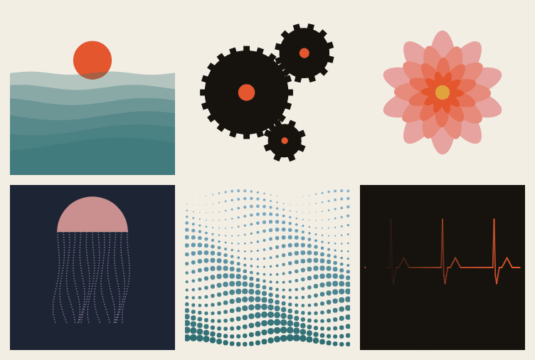

<p align="center"></p>

# Squiggle

**Code you can post.** Squiggle is a small creative-coding language where every program is a short moving drawing. Write a few lines, watch them move, and share the whole thing in one post: most pieces fit in 280 characters, so the code *is* the post.

```
paper ink
every frame
  repeat 48 as i
    a = i / 48 * turn + t * 0.3
    dot cos(a) * 140, sin(a * 2) * 90, 3, hue(i * 7)
```

- **Studio** (`/studio`): code on the left, live sheet on the right, a meter that counts toward 280, share links with the code inside, PNG and 6-second MP4/GIF export.
- **Wall** (`/wall`): pinned pieces with live previews, likes, remix families, a weekly prompt, and a share card for every link.
- **Learn** (`/learn`): ten short steps from a first dot to your first post-sized piece.
- **Reference** (`/reference`): every command and built-in with a live example.
- **CLI**: `npx squigglelang render piece.sqg --out piece.png` on macOS, Linux and Windows.
- **Editor support**: a VS Code extension, and a GitHub Action that renders `.sqg` files for your README.

The full language is in [LANGUAGE.md](LANGUAGE.md).

## The language in one screen

One instruction per line; indented lines belong to the block above them. The sheet is 512 × 512 with `0, 0` in the middle and y pointing up.

| | |
|---|---|
| shapes | `dot x, y, size` · `ring x, y, size` · `box x, y, w, h` · `line x1, y1, x2, y2` · `path points` · `shape points` · `write "text", x, y` (each takes an optional color last) |
| style | `paper color` · `color c` · `width w` |
| transforms | `move x, y` · `spin a` · `grow s` · `keep` (undoes them at the end of its block) |
| blocks | `every frame` (`t` is seconds) · `repeat n as i` · `for p in list` · `if` / `else` · `when key "space"` · `when click` · `make name a, b` |
| values | numbers, `"text"`, lists `[1, 2]`, points `(x, y)`, colors (`ink`, `ember`, `sea`… `#hex`, `hue(h)`, `mix(a, b, k)`) |
| math | `sin cos turn noise rand lerp clamp ease floor abs` and more |

Same code and same `t` give the same pixels everywhere: `rand` is seeded, `noise` uses a fixed table, and coordinates snap to 1/256 px. Errors point at the line and column and suggest a fix:

```
line 3, col 3: dot needs 3 numbers: x, y, size (got 2)
  3 |   dot 10, 20
    |   ^^^
try: dot x, y, size [, color]
```

## Run it anywhere

```
npx squigglelang render tide.sqg --out tide.png
npx squigglelang render tide.sqg --seconds 6 --out tide.mp4     # or .gif
npx squigglelang shell                                           # try values line by line
npx squigglelang tidy tide.sqg -w                                # standard layout
npx squigglelang squeeze tide.sqg                                # shortest safe version + count
```

Install it for good with `npm i -g squigglelang`, or with the helper scripts (they only wrap npm):

```
curl -fsSL https://squigglee.online/install.sh | sh          # macOS, Linux
irm https://squigglee.online/install.ps1 | iex               # Windows PowerShell
```

**VS Code**: download [squiggle.vsix](https://squigglee.online/downloads/squiggle.vsix) and run *Extensions: Install from VSIX…*. You get highlighting, snippets, a post counter in the status bar, and *Open in Squiggle Studio*.

**GitHub Action**: render every `.sqg` in a repo to PNG on push. See [action/squiggle-render](action/squiggle-render/README.md).

<!-- sync:action-uses -->
```yaml
- uses: YOUR-ACCOUNT/squiggle/action/squiggle-render@main
  with:
    commit: 'true'
```
<!-- /sync:action-uses -->

## How it's built

| folder | what's there |
|---|---|
| `packages/core` | `squiggle-core`: lexer with indentation tokens, recursive-descent parser, tree-walking interpreter that draws into a display list, Canvas2D and SVG renderers, tidy, squeeze, share links. No dependencies. |
| `packages/cli` | `squigglelang` on npm: `@napi-rs/canvas` for pixels, a WebAssembly H.264 encoder for MP4, gifenc for GIF. |
| `packages/vscode` | the VS Code extension; its grammar is generated from the core vocabulary. |
| `site` | the Cloudflare Worker (D1 for pieces and likes, R2 for renders, KV for rate limits) and the Vite client. Pieces run in a Web Worker with OffscreenCanvas; pinning re-runs them on the server with resvg. |
| `action/squiggle-render` | the GitHub Action. |
| `examples`, `seeds` | the 30 starters and the 12 pieces that opened the wall. |

Design decisions are numbered in [DECISIONS.md](DECISIONS.md); the current state is in [REPORT.md](REPORT.md).

### Develop

```
npm install
npm test                 # language suite, determinism hashes, Worker API
npm run typecheck
npm run build:cli        # packages/cli/dist and the action bundle
npm run build:site
cd site && npx wrangler d1 migrations apply squiggle --local && npx wrangler dev
npm run e2e              # Playwright against the local Worker
```

## License

MIT. Fonts: Fraunces and JetBrains Mono, both under the SIL Open Font License.
